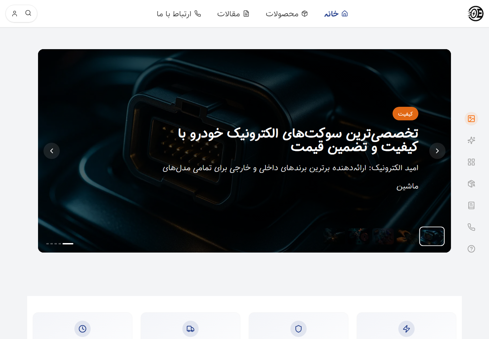

# Sucket Electronic — سوکت الکترونیک

A Persian, right-to-left storefront for automotive electrical connectors and related parts. This is the **Next.js frontend** of the client project; its Django API is maintained in the separate [SucketElectronicBackend repository](https://github.com/boyInShadows/SucketElectronicBackend).

**Status:** existing client application with a locally verified catalog connection. Commercial launch, live payment processing and complete authentication/order flows were not established by this review.

**Ramtin Farzane's contribution:** development of both the frontend and backend, confirmed by Ramtin.



## What is implemented

The application includes a Persian storefront, category/product browsing, article and contact screens, responsive navigation, and Django-backed account/product-management code. Its source includes animation, loading/error presentation and a map component. Dependency presence alone is not evidence that a service is configured or working.

The active API helper builds Django URLs with trailing slashes and forwards bearer tokens for authenticated calls. Browser authentication state is stored in localStorage. NextAuth and Stripe scaffold files also exist, but their presence does not establish a working OAuth session, payment gateway, PCI compliance, wallet support or confirmation emails. The earlier README's claims of those capabilities have been removed.

## Run locally

Clone the repositories independently; a sibling `backend/` folder is not bundled here:

```bash
git clone https://github.com/boyInShadows/sucketElectronic.git
cd sucketElectronic
npm ci
```

Start the Django API separately on `http://localhost:8000` using its declared requirements and migrations. Provide these non-secret values in the terminal environment before starting or building the frontend:

```text
NEXT_PUBLIC_API_URL=http://localhost:8000
INTERNAL_API_URL=http://localhost:8000
```

```bash
npm run dev
```

Open `http://localhost:3000`. The [setup and verification guide](docs/README.md) explains origins, API routing, commands, evidence and current limitations. Real credentials belong in Windows user environment variables on the maintainer's workstation.

## Stack and evidence

Next.js 15.1.7, React 19, JavaScript, Tailwind CSS, Framer Motion and a separate Django REST API. Verification used Node 24.11.1/npm 11.6.2 and Python 3.13.16/Django 5.2.4 for an isolated synthetic catalog. These versions describe the inspected checkout, not a recommendation to deploy its old dependency graph unchanged.

The production web build connected to a fresh Django database and displayed four synthetic products. Desktop/mobile and product-proxy results are in [browser evidence](docs/artifacts/browser-results.json). The capture uses existing repository imagery and synthetic records, without customer accounts or production services.

`npm run lint` currently fails with a parser-serialization error. `npm run build` exits successfully but also prints that lint diagnostic. The dependency audit reports **196 findings, including 15 critical and 57 high** on the reviewed lockfile. See [recorded outcomes](docs/README.md#verification-and-known-limits); no green quality badge or production-security claim is made.

## Persian overview

این مخزن رابط کاربری پروژه مشتری «سوکت الکترونیک» است. بک‌اند جنگو در مخزن جداگانه قرار دارد. نمایش محصولات با داده آزمایشی محلی بررسی شده است؛ این بررسی به معنی تأیید پرداخت واقعی، عرضه تجاری یا مالکیت انفرادی همه بخش‌های پروژه نیست.

Existing project ownership and asset credits remain applicable. This documentation does not assign a new license or change repository URLs.
